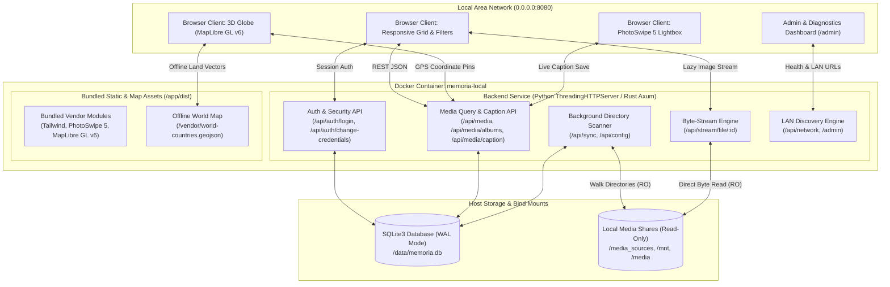
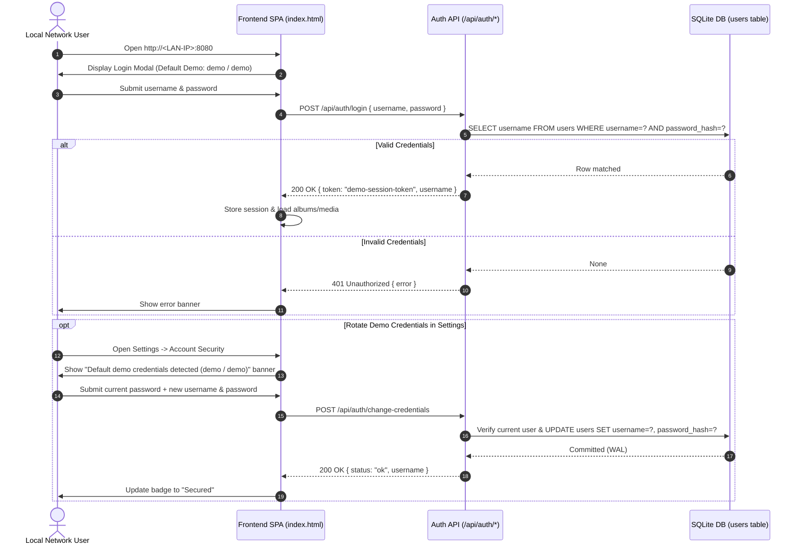
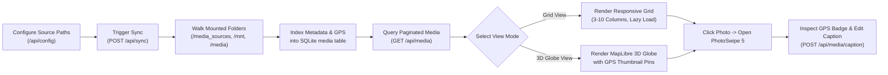

# System Overview & Architecture — Memoria v2

**Memoria v2** is a self-hosted, privacy-first local photo and video web vault engineered to index, stream, and visualize media libraries across local networks (LAN). It pairs a zero-external-dependency Single-Page Application (SPA) frontend—featuring virtualized responsive grids, multi-theme styling, PhotoSwipe 5 lightboxes with live SQLite caption persistence, and an offline/online hybrid MapLibre GL 3D Globe—with a multi-threaded Python or Rust (Axum + Tokio) backend backed by SQLite in `Write-Ahead Logging` (WAL) mode.

---

## 1. High-Level System Architecture

---

## 2. Core Functional Workflows

### 2.1 Authentication & Credential Hardening Workflow

Memoria v2 ships with sandboxed demo credentials (`demo` / `demo`) for immediate evaluation and detects default credentials in the Settings UI, guiding administrators through live credential rotation without restarting the container.

### 2.2 Media Indexing, Filtering & Lightbox Inspection Workflow

### 2.3 3D Globe Rendering Pipeline

To ensure the 3D Globe functions reliably across both offline local networks and internet-connected environments, Memoria v2 uses a multi-layered rendering pipeline:

1. **WebWorker Pre-Configuration:** Configures `maplibregl.setWorkerUrl('/vendor/maplibre-gl-worker.mjs')` so ES module workers initialize cleanly from local static storage.
2. **Offline Base Vector Layer:** Loads bundled Natural Earth country polygons (`/vendor/world-countries.geojson`) for immediate continent fills (`#1e3e62`) and country borders (`#3b82f6`) over a deep-ocean sphere (`#0b192c`).
3. **Hybrid Raster Detail Layer:** Overlays OpenStreetMap raster tiles (`https://tile.openstreetmap.org/{z}/{x}/{y}.png`) when internet connectivity is available for street-level zoom inspection.
4. **Interactive Photo Pin Anchors:** Projects every media item with valid `latitude` and `longitude` onto the 3D sphere as a circular thumbnail pin that opens the exact image inside the PhotoSwipe lightbox when clicked.

---

## 3. Database Schema (SQLite WAL)

```mermaid
erDiagram
    users {
        INTEGER id PK
        TEXT username UK "Default: demo"
        TEXT password_hash "Default: demo"
        DATETIME created_at
    }
    sources_config {
        INTEGER id PK
        TEXT album_name
        TEXT path_location UK
        TEXT tags
        DATETIME last_synced
    }
    media {
        INTEGER id PK
        INTEGER source_id FK
        TEXT album_name
        TEXT file_path UK
        TEXT file_type "image | video"
        TEXT date_taken "ISO-8601"
        REAL latitude "Nullable GPS Lat"
        REAL longitude "Nullable GPS Lon"
        TEXT caption "Editable note"
        TEXT thumb_hash
        TEXT tags
    }
    sources_config ||--o{ media : "indexes"
```

---

## 4. Security & Demo Configuration Model

| Layer | Configuration | Default / Demo Value | Production Hardening |
| :--- | :--- | :--- | :--- |
| **Authentication** | Initial Seed Account | `demo` / `demo` | Rotate immediately via **⚙️ Settings $\rightarrow$ Account Security** (`POST /api/auth/change-credentials`). |
| **Network Binding** | Container & Host Port | `0.0.0.0:8080->8080/tcp` | Restrict to localhost (`127.0.0.1:8080:8080`) if placing behind an HTTPS reverse proxy (Nginx / Caddy / Traefik). |
| **LAN Discovery** | `HOST_NETWORK_URLS` | `http://memoria-demo.local:8080`, `http://192.168.1.100:8080` | Override via `HOST_NETWORK_URLS` or set `AUTO_DETECT_LAN=1` in `docker-compose.yml`. |
| **Storage Mounts** | Media Volume Permissions | `:ro` (Read-Only) | Media shares (`/media_sources`, `/mnt`, `/media`) are mounted read-only so the container can never modify or delete original files. |
| **Database Isolation** | SQLite WAL Volume | `./data:/data` (`rw`) | Excluded from Git via `.gitignore` (`data/*.db*`) so user credentials and private metadata are never committed. |
