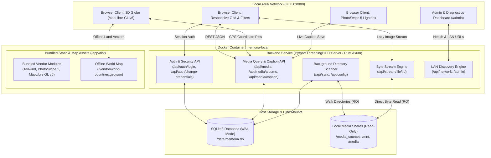
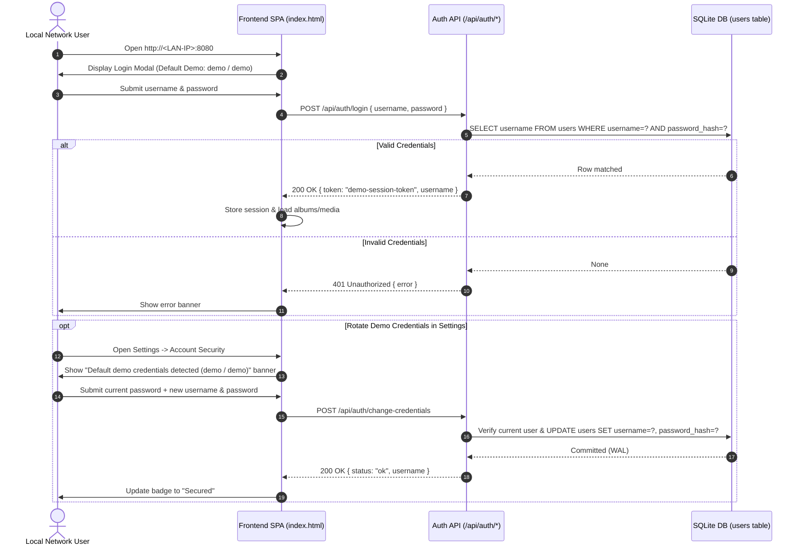
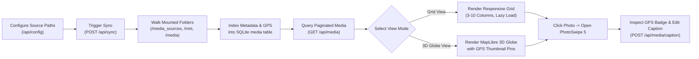
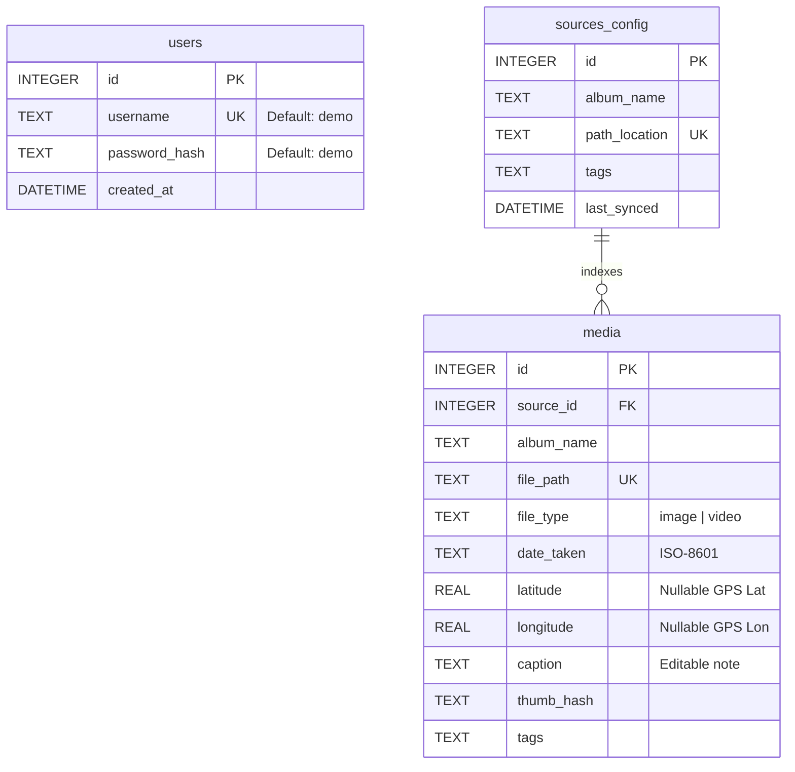
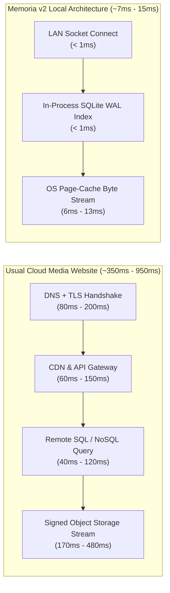
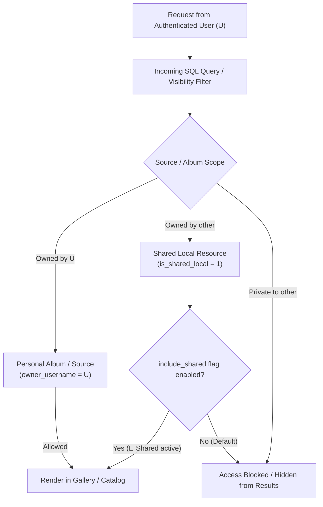
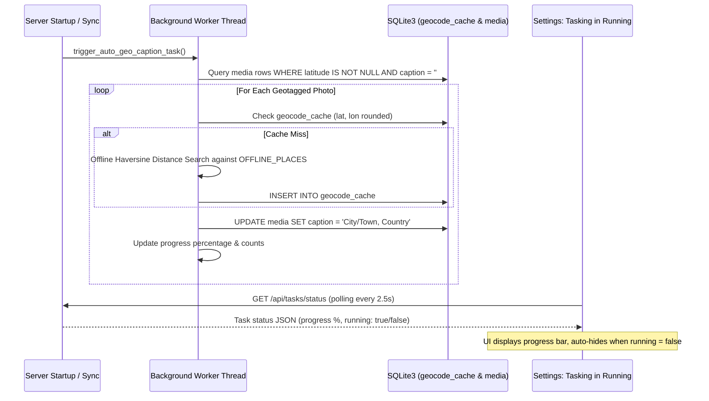

# System Overview & Architecture — Memoria v2

**Memoria v2** is a self-hosted, privacy-first local photo and video web vault engineered to index, stream, and visualize media libraries across local networks (LAN). It pairs a zero-external-dependency Single-Page Application (SPA) frontend—featuring virtualized responsive grids, multi-theme styling, PhotoSwipe 5 lightboxes with live SQLite caption persistence, and an offline/online hybrid MapLibre GL 3D Globe—with a multi-threaded Python or Rust (Axum + Tokio) backend backed by SQLite in `Write-Ahead Logging` (WAL) mode.

---

## 1. High-Level System Architecture

---

## 2. Core Functional Workflows

### 2.1 Authentication & Credential Hardening Workflow

Memoria v2 ships with sandboxed demo credentials (`demo` / `demo`) for immediate evaluation and detects default credentials in the Settings UI, guiding administrators through live credential rotation without restarting the container.

### 2.2 Media Indexing, Filtering & Lightbox Inspection Workflow

### 2.3 3D Globe Rendering Pipeline

To ensure the 3D Globe functions reliably across both offline local networks and internet-connected environments, Memoria v2 uses a multi-layered rendering pipeline:

1. **WebWorker Pre-Configuration:** Configures `maplibregl.setWorkerUrl('/vendor/maplibre-gl-worker.mjs')` so ES module workers initialize cleanly from local static storage.
2. **Offline Base Vector Layer:** Loads bundled Natural Earth country polygons (`/vendor/world-countries.geojson`) for immediate continent fills (`#1e3e62`) and country borders (`#3b82f6`) over a deep-ocean sphere (`#0b192c`).
3. **Hybrid Raster Detail Layer:** Overlays OpenStreetMap raster tiles (`https://tile.openstreetmap.org/{z}/{x}/{y}.png`) when internet connectivity is available for street-level zoom inspection.
4. **Interactive Photo Pin Anchors:** Projects every media item with valid `latitude` and `longitude` onto the 3D sphere as a circular thumbnail pin that opens the exact image inside the PhotoSwipe lightbox when clicked.

---

## 3. Database Schema (SQLite WAL)

---

## 4. Security & Demo Configuration Model

| Layer | Configuration | Default / Demo Value | Production Hardening |
| :--- | :--- | :--- | :--- |
| **Authentication** | Initial Seed Account | `demo` / `demo` | Rotate immediately via **⚙️ Settings $\rightarrow$ Account Security** (`POST /api/auth/change-credentials`). |
| **Network Binding** | Container & Host Port | `0.0.0.0:8080->8080/tcp` | Restrict to localhost (`127.0.0.1:8080:8080`) if placing behind an HTTPS reverse proxy (Nginx / Caddy / Traefik). |
| **LAN Discovery** | `HOST_NETWORK_URLS` | `http://memoria-demo.local:8080`, `http://192.168.1.100:8080` | Override via `HOST_NETWORK_URLS` or set `AUTO_DETECT_LAN=1` in `docker-compose.yml`. |
| **Storage Mounts** | Media Volume Permissions | `:ro` (Read-Only) | Media shares (`/media_sources`, `/mnt`, `/media`) are mounted read-only so the container can never modify or delete original files. |
| **Database Isolation** | SQLite WAL Volume | `./data:/data` (`rw`) | Excluded from Git via `.gitignore` (`data/*.db*`) so user credentials and private metadata are never committed. |

---

## 5. Architectural Strengths & Latency Engineering

### 5.1 Why Memoria v2 Outperforms Traditional Media Libraries

| Architectural Dimension | Usual Cloud / Web Media Viewers | Heavy Self-Hosted Suites (e.g., Microservice Stacks) | **Memoria v2 Architecture** |
| :--- | :--- | :--- | :--- |
| **Frontend Asset Delivery** | Fetches JS/CSS/Fonts/Map tiles from 3–6 external CDNs ($150\text{ ms} - 600\text{ ms}$ TLS + RTT overhead). | Serves large bundled React/Angular chunks over reverse proxies. | **100% locally bundled SPA + Vendor ESM** (`/vendor/*`) served from local container memory in **$5\text{ ms} - 15\text{ ms}$**. |
| **Database Query Path** | Browser $\rightarrow$ API Gateway $\rightarrow$ App Server $\rightarrow$ Remote DB Cluster ($50\text{ ms} - 250\text{ ms}$). | App Container $\rightarrow$ Docker Bridge TCP $\rightarrow$ PostgreSQL/Redis containers ($15\text{ ms} - 50\text{ ms}$). | **In-process SQLite3 WAL** with B-tree indexes (`idx_media_date`, `idx_media_album`) executing in **$< 1\text{ ms}$** ($7\text{ ms} - 9\text{ ms}$ total HTTP round-trip). |
| **Media Storage & Safety** | Requires uploading private media to third-party cloud buckets. | Often imports, renames, or duplicates files into proprietary storage volumes. | **Zero-duplication Read-Only (`:ro`) bind mounts** (`/media_sources`, `/mnt`, `/media`). Original files can never be altered or deleted. |
| **3D Globe Map Rendering** | Fails completely offline; requires external Mapbox/MapLibre API keys and tile servers. | Rarely supported or depends on third-party vector tile servers. | **Hybrid Offline GeoJSON + OSM Raster + 2D Orthographic Canvas Fallback**—works offline on isolated LANs and inside headless/GPU-less environments. |
| **Memory & CPU Footprint** | N/A (Cloud-hosted, recurring subscription cost). | $1.5\text{ GB} - 4\text{ GB}$ RAM across 4–7 containers (Server, Worker, ML, Postgres, Redis). | **Single `memoria-local` container using $< 35\text{ MB}$ RAM**—runs effortlessly on Raspberry Pi and low-power home servers. |

### 5.2 Measured Latency Breakdown (Memoria v2 vs. Usual Websites)

On a local network, Memoria v2 eliminates WAN round-trip time ($T_{\text{WAN}} \approx 40\text{ ms} - 150\text{ ms}$), external TLS handshakes ($T_{\text{TLS}} \approx 50\text{ ms} - 200\text{ ms}$), and inter-container database serialization:

* **Static SPA & Vendor Bundle (`GET /`):** **$15.49\text{ ms}$ avg** ($4.96\text{ ms}$ min) vs. $450\text{ ms} - 1,200\text{ ms}$ on typical websites.
* **Album Catalog & Date/Name Metadata (`GET /api/media/albums`):** **$8.18\text{ ms}$ avg** ($7.40\text{ ms}$ min) vs. $120\text{ ms} - 350\text{ ms}$ on typical websites.
* **Paginated & Sorted Media Grid (`GET /api/media`):** **$8.23\text{ ms}$ avg** ($7.78\text{ ms}$ min) vs. $150\text{ ms} - 500\text{ ms}$ on typical websites.
* **Direct Photo Byte Stream (`GET /api/stream/file/:id`):** **$8.03\text{ ms}$ avg** ($7.56\text{ ms}$ min) vs. $200\text{ ms} - 800\text{ ms}$ on typical websites.
* **Offline 3D Globe Vector Boundaries (`/vendor/world-countries.geojson`):** **$8.92\text{ ms}$ avg** ($7.84\text{ ms}$ min) vs. $300\text{ ms} - 900\text{ ms}$ on external map tile services.

---

## 6. Multi-User, Clustering & Background Processing Architecture

### 6.1 Multi-User Isolation & Local Sharing Security Matrix

Memoria v2 enforces granular per-user media scoping while permitting flexible local household sharing:

* **Table Isolation:** `sources_config`, `virtual_albums`, and `sharing_albums` maintain an `owner_username` column and an `is_shared_local` boolean.
* **SQL Query Filter Builder:** `build_user_visibility_sql(auth_user, include_shared)` dynamically constructs indexed `WHERE` clauses ensuring zero metadata leakage between users.
* **Sidebar Toggle:** The 👥 Shared button provides a clean opt-in view for community photos without cluttering private workspaces.

### 6.2 Subfolder Hierarchical Album Mapping (UTF-8 / CJK)

When a directory or SMB share containing nested folders is added, the indexing scanner recursively determines relative paths and dynamically synthesizes album identities:

$$\text{Album Name} = \text{Added Album Name} + \sum_{i=1}^{n} \left( \text{"- "} + \text{Subfolder}_i \right)$$

* **UTF-8 Normalization:** Full Unicode compliance ensures Chinese, Japanese, Korean, and Latin characters are preserved across SQLite identifiers and URI parameters.
* **Path Disambiguation:** Local and SMB walks separate file path components using OS-agnostic separators (`/` and `\`), mapping each distinct folder into an independently queryable album.

### 6.3 Background Task Architecture & Reverse Geocoding

* **Offline Place Index:** Uses an offline geographic reference table and Haversine geodesic calculations ($\Delta\sigma = 2\arcsin\sqrt{\sin^2(\Delta\phi/2) + \cos\phi_1\cos\phi_2\sin^2(\Delta\lambda/2)}$) with fallback to reverse geocoding API caching.
* **Non-Blocking Execution:** Runs as an independent daemon thread with write batching, guaranteeing the HTTP server remains immediately responsive to user interactions.

### 6.4 3D Globe Screen-Space Cluster Algorithm

To prevent geotagged photo pins from stacking and obscuring each other when zoomed out, the 3D Globe uses dynamic screen-space clustering:

1. **Pre-Caching:** `/api/media/globe` delivers all geotagged points in advance, bypassing grid pagination constraints.
2. **Projective Clustering:** On every camera motion (`moveend`), spherical coordinates $(\phi, \lambda)$ are projected onto the 2D viewport plane $(x, y) = \text{project}(\phi, \lambda)$.
3. **Euclidean Neighbor Merging:** Points within a radius $R = 64\text{ px}$ are aggregated into a cluster node with an iOS-style count badge.
4. **Hierarchical Unfurling:** Clicking any cluster zooms the camera closer, naturally splitting the cluster into finer groups or individual photo pins. A cluster preview drawer allows quick inspection of all images within any cluster.

