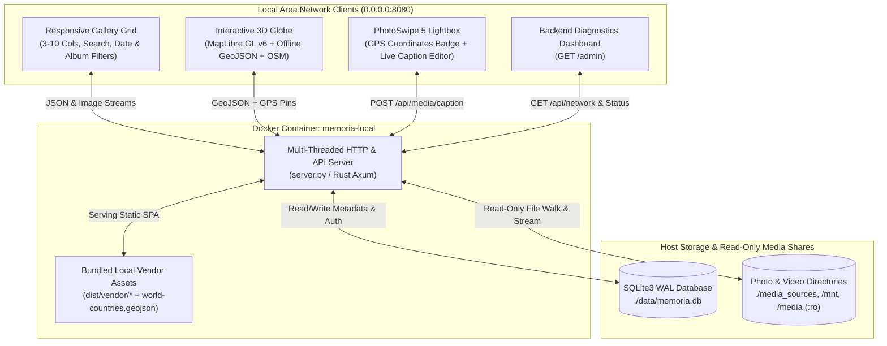
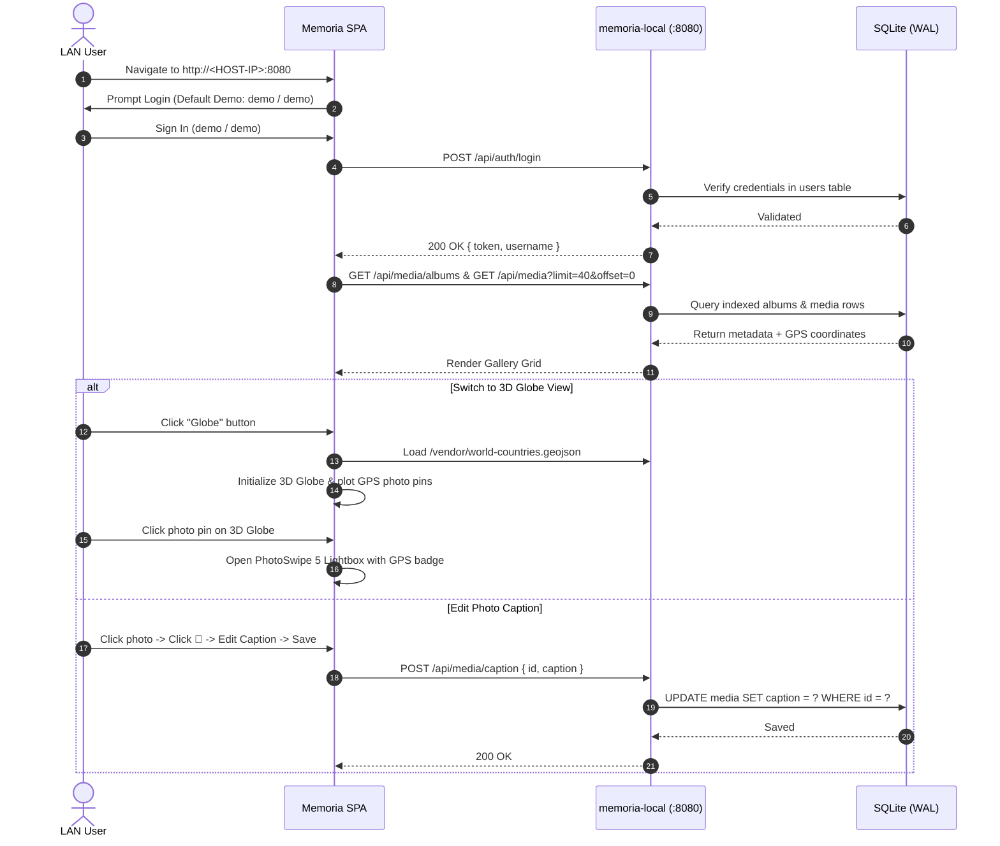

# Memoria v2: Self-Hosted Local Photo & Video Web Vault

**Memoria v2** is a self-hosted, browser-based photo and video vault engineered to index, stream, and visualize local media folders and network shares across your Local Area Network (LAN). It features a responsive multi-theme grid, dynamic PhotoSwipe 5 lightboxes with live SQLite caption editing, an offline/online hybrid MapLibre GL v6 3D Globe viewer with EXIF GPS thumbnail pins, and full LAN discovery.

> [!TIP]
> For deep-dive sequence diagrams, ER diagrams, and security model details, see [ARCHITECTURE.md](ARCHITECTURE.md).

---

## 1. System Overview & Architecture



### Core Capabilities & v2 Enhancements
* **Full Local Network (LAN) Access:** Binds to `0.0.0.0:8080` with multi-threaded request handling (`ThreadingMixIn`) so multiple devices on your Wi-Fi/LAN can browse and stream media concurrently.
* **Hybrid Offline/Online 3D Globe (`MapLibre GL v6`):** Renders a true 3D Earth sphere (`projection: { type: 'globe' }`) using bundled offline country boundary vectors (`/vendor/world-countries.geojson`) layered with OpenStreetMap raster tiles and interactive photo pins for every geotagged image.
* **Demo-Safe Security & Live Credential Rotation:** Ships with default demo credentials (`demo` / `demo`) and an automatic security banner in **⚙️ Settings** allowing instant username/password updates directly to SQLite without container restarts.
* **Zero External JS/CSS Dependencies:** Tailwind CSS, PhotoSwipe 5, MapLibre GL JS v6, WebWorkers, and world vector maps are bundled locally in `dist/vendor/`.

---

## 2. Application Workflow



---

## 3. Visual Previews & Screenshots

| 1. Demo Authentication Gate (`demo / demo`) | 2. Virtualized Gallery Grid & Album Catalog |
| :---: | :---: |
|  |  |

| 3. Collapsible Date Range Filter | 4. Settings, Security & LAN Access Modal |
| :---: | :---: |
|  |  |

| 5. Interactive 3D Globe Viewer | 6. PhotoSwipe Lightbox & Caption Editor |
| :---: | :---: |
|  |  |

| 7. Backend Diagnostics & LAN Discovery Dashboard (`/admin`) |
| :---: |
|  |

---

## 4. Repository File Layout

```text
Memoria-v2/
├── ARCHITECTURE.md                   # Detailed architecture, sequence & ER diagrams
├── README.md                         # Deployment guide & documentation
├── Dockerfile                        # Container build with Python 3.12, FFmpeg & SQLite3
├── docker-compose.yml                # "memoria-local" service definition & LAN port bindings
├── Cargo.toml                        # Optional Rust (Axum + Tokio + SQLx) build manifest
├── server.py                         # Multi-threaded Python backend & diagnostics server
├── src/
│   └── main.rs                       # Rust Axum backend server implementation
├── dist/
│   ├── index.html                    # Single-Page Application (Grid, 3D Globe, Lightbox, Settings)
│   └── vendor/                       # Bundled offline assets (MapLibre, PhotoSwipe, Tailwind, GeoJSON)
├── media_sources/                    # Sample photography albums (Nature, Cities, California, Japan)
└── screenshots/                      # Full UI screenshots across all views
```

---

## 5. Deployment Instructions

### Prerequisites
* **Docker** (v20.10+) and **Docker Compose** (or `docker run`) installed.
* Or **Python 3.10+** for standalone host execution.

---

### Option A: Deploy with Docker (`memoria-local` on Port 8080)

#### 1. Clone the Repository
```bash
git clone https://github.com/chiuhung0508/Memoria-v2.git
cd Memoria-v2
mkdir -p data
```

#### 2. Build & Launch the `memoria-local` Container
Using `docker build` and `docker run` (works on all Docker installations with or without the Compose plugin):

```bash
docker build -t memoria-local:latest .

docker run -d \
  --name memoria-local \
  --restart unless-stopped \
  -p 0.0.0.0:8080:8080 \
  -v "$(pwd)/data:/data" \
  -v "$(pwd)/media_sources:/app/media_sources:ro" \
  -v "$(pwd)/media_sources:/media_sources:ro" \
  -v /mnt:/mnt:ro \
  -v /media:/media:ro \
  -e HOST=0.0.0.0 \
  -e PORT=8080 \
  -e DB_PATH=/data/memoria.db \
  -e "HOST_NETWORK_URLS=http://memoria-demo.local:8080,http://192.168.1.100:8080" \
  memoria-local:latest
```

*(Alternatively, if `docker compose` is installed, run `docker compose up --build -d`.)*

#### 3. Verify Container & Logs
```bash
docker ps --filter name=memoria-local
docker logs memoria-local
```

---

### Option B: Standalone Local Deployment (Python)

Run the multi-threaded Python server directly on your host:

```bash
python3 server.py
```

---

## 6. Accessing & Configuring Memoria on Your Local Network

1. **Open the Web Vault:**
   * **On the host machine:** `http://localhost:8080`
   * **From any device on your local network:** `http://<YOUR-LAN-IP>:8080`
   * **Backend Diagnostics Dashboard:** `http://<YOUR-LAN-IP>:8080/admin`
2. **Sign In with Demo Credentials:**
   * **Username:** `demo`
   * **Password:** `demo`
3. **Harden Account Credentials:**
   * Click **⚙️ Settings** in the top navigation bar.
   * Under **🔐 Account Security & Credentials**, enter the current demo password (`demo`), specify your new custom username and strong password (minimum 4 characters), and click **Update Credentials**.
4. **Add & Sync Custom Photo/Video Folders:**
   * In **⚙️ Settings $\rightarrow$ Source Directories & SMB Shares**, click **+ Add Path**.
   * Enter an Album Name and container-mounted path (e.g., `/mnt/nas_photos` or `/media/usb_drive`).
   * Click **Save Sources**, then click **🔄 Reload Index & Sync Database**.
